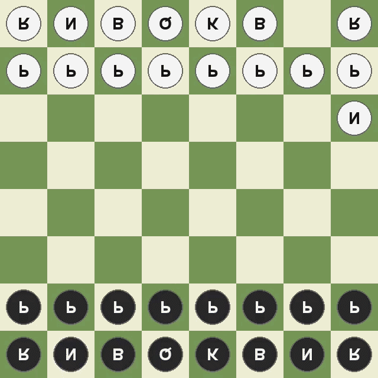

[English](README.md) | [فارسی](README_FA.md)

# ChessRL ♟️

A reinforcement learning chess agent built from scratch using **PyTorch**.

## Demo

A sample gameplay session:



The agent in this demo is not fully trained. It can play complete games but still makes many mistakes, and playing strength has not been formally evaluated.

This project explores how reinforcement learning can be applied to chess by implementing the full pipeline: environment design, neural network architecture, PPO training, self-play, and search experiments.

The goal of this project is not to create a world-class chess engine, but to gain practical experience with reinforcement learning engineering and deep learning system design.

🛑 **Project Status: Paused / Concluded**

This project is being shared as-is. Development has stopped, primarily due to hardware limitations (GTX 1650 4GB, i5-4570, 16GB RAM) that made meaningful self-play training impractical — MCTS simulation and rollout generation are CPU-heavy and the training loop would have needed far more compute and time than this machine could reasonably provide. Rather than let it sit unfinished indefinitely, I'm releasing it in its current state, flaws included.

Known limitations at time of release:

* Training was not run to convergence — the agent has not seen enough self-play games to develop strong chess understanding.
* Some parts of the RL pipeline (e.g. GAE/advantage usage) may not be fully wired into the final loss calculation and could use a review pass.
* MCTS integration remains experimental rather than fully tuned.
* Performance/strength has not been rigorously benchmarked.

I'm moving on to a new project, but the code, architecture, and lessons learned here are documented below for anyone who wants to pick it up, learn from it, or fork it.

---

# Motivation

Reinforcement learning is a field where understanding comes from building and experimenting.

Instead of only studying RL algorithms theoretically, this project was created to explore:

* How an agent learns from interaction
* How policy and value networks work together
* How self-play can improve decision making
* How search methods like MCTS can complement neural networks

This project is also a portfolio project demonstrating practical AI engineering skills.

---

# Features

## Reinforcement Learning Pipeline

Implemented a PPO-inspired reinforcement learning pipeline including:

* Actor-Critic architecture
* Rollout buffer
* Generalized Advantage Estimation (GAE) module
* Self-play training support
* MCTS-guided move selection

---

## Training Approaches

The project currently uses two training stages.

## 1. Supervised Pre-training

File:

```
pre_train.py
```

Before reinforcement learning, the model can be trained using chess game data.

Purpose:

* Give the model an initial understanding of chess positions
* Provide a stronger starting point before reinforcement learning

Training data is based on chess game records.

---

## 2. Reinforcement Learning Training

File:

```
train.py
```

The agent learns through self-play interaction, guided by MCTS.

The agent supports:

* Self-play training
* Learning from generated experience
* Policy and value optimization

The model can also be played against through:

```
play.py
```

---

# Neural Network Architecture

The agent uses a convolutional neural network inspired by architectures commonly used in modern board-game AI.

Architecture:

```
Chess Board Tensor
        |
        v
Convolution Layers
        |
        v
Batch Normalization + ReLU
        |
        v
Residual Blocks (4x)
        |
        v
Feature Projection (256)
        |
        +----------------+
        |                |
        v                v
   Policy Head       Value Head
    (Actor)          (Critic)
```

The network contains:

* CNN layers for spatial board understanding
* BatchNorm2d layers
* ReLU activation functions
* Four residual blocks
* Actor head for move probabilities
* Critic head for board evaluation

---

# Chess Board Representation

The chess state is represented as:

```
8 x 8 x 18
```

tensor with `float32` values.

The board representation uses multiple feature planes to encode chess information and is processed by convolution layers.

Implementation:

```
chess_rl/env/chess_env.py
```

---

# Legal Move Masking

One of the first challenges during development was that an untrained neural network does not understand chess rules.

Early experiments showed the model selecting impossible actions, such as attempting illegal piece movements.

To solve this, legal move masking was implemented.

The policy output is filtered so the agent can only select moves that are valid in the current chess position.

This improves training stability and prevents the model from wasting experience on impossible actions.

---

# MCTS Experiment

During development, an experimental Monte Carlo Tree Search (MCTS) module was implemented.

The motivation was to explore whether tree-based search could help the neural network avoid obvious mistakes by looking ahead at possible future positions.

Current status:

* MCTS prototype implemented
* Used as an experimental search component
* Further integration and improvement were planned, but not completed before the project was paused

Implementation:

```
chess_rl/mcts/
```

---

# Project Structure

```
ChessRL/
│
├── train.py                  # PPO training
├── pre_train.py              # Supervised pre-training
├── play.py                   # Play against the agent
│
├── chess_rl/
│   │
│   ├── env/                  # Chess environment
│   │
│   ├── models/               # Neural network architecture
│   │
│   ├── ppo/                  # PPO implementation
│   │
│   ├── mcts/                 # MCTS experiments
│   │
│   └── tests/                # Unit tests
│
├── requirements.txt
└── README.md
```

---

# Technologies

Built with:

* Python
* PyTorch
* NumPy
* python-chess

---

# Current Progress

Implemented:

✅ Custom chess environment
✅ Chess board tensor representation
✅ CNN + Residual network architecture
✅ Actor-Critic model
✅ Self-play training loop
✅ GAE module (calculation implemented; full integration into the loss not finalized)
✅ Rollout buffer
✅ Legal move masking
✅ Human vs AI gameplay
✅ Experimental MCTS implementation

Not completed:

❌ Full training run to convergence
❌ Playing-strength evaluation / benchmarking
❌ Finalized advantage-weighted loss

---

# Why This Project Was Paused

This project was built and trained on modest consumer hardware (GTX 1650 4GB, i5-4570, 16GB RAM). Self-play RL for chess — running MCTS simulations plus neural network training — is compute-intensive, and this setup wasn't able to produce enough training throughput to get the agent to a strong or fully validated state in a reasonable timeframe.

Rather than leave the repository without an explanation, I'm documenting this openly: the pipeline works end-to-end, but the *results* (playing strength, training stability, full algorithm correctness) are unfinished. I'm choosing to conclude this project here and move on to something new, and may revisit it in the future with better hardware or a lighter-weight training approach.

---

# Future Improvements

If picked back up (by me or anyone else), planned improvements would include:

* Finish wiring advantage-weighted loss (or simplify to a pure AlphaZero-style policy distillation objective)
* Reduce network size / simulation count to better fit limited hardware
* Add evaluation metrics and measure playing strength
* Improve self-play stability
* Tune hyperparameters
* Improve MCTS integration
* Compare different training strategies
* Create better gameplay visualization

---

# Lessons Learned

Building this project helped explore practical challenges in reinforcement learning:

* Designing useful state representations
* Handling invalid actions
* Debugging unstable RL training
* Understanding policy/value networks
* Combining learning-based methods with search algorithms
* Scoping an ML project realistically against available hardware

The project is a snapshot of an ongoing learning process — closed here for now, not because it "worked," but because building it taught what it set out to teach.

---

# License

This project is released under the MIT License.

---

