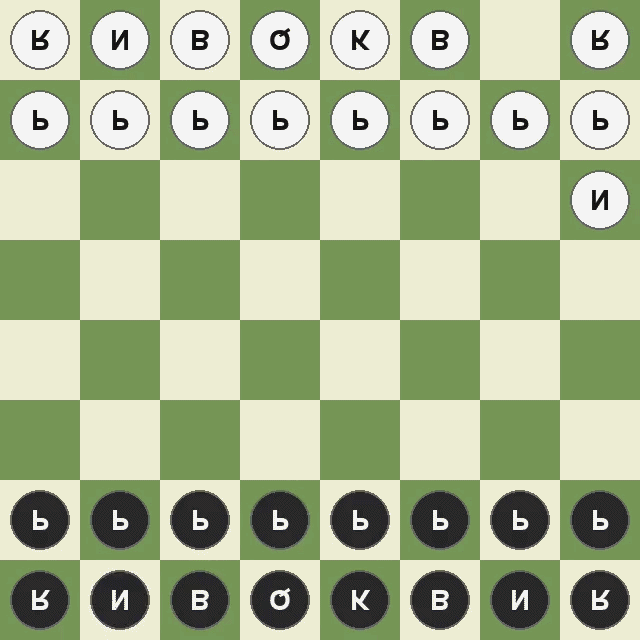

[English](README.md) | [فارسی](README_FA.md)

# ChessRL ♟️

یک عامل شطرنج مبتنی بر یادگیری تقویتی که با استفاده از **PyTorch** ساخته
شده است.

این پروژه به بررسی کاربرد یادگیری تقویتی در شطرنج می‌پردازد و با
پیاده‌سازی بخش‌های مختلف این فرایند، از طراحی محیط و معماری شبکه عصبی
گرفته تا آموزش با PPO، خودبازی (Self-Play) و آزمایش روش‌های جست‌وجو،
تجربه‌ای عملی فراهم می‌کند.

هدف این پروژه ساخت یک موتور شطرنج در سطح جهانی نیست؛ بلکه کسب تجربه عملی
در مهندسی یادگیری تقویتی و طراحی سامانه‌های یادگیری عمیق است.

🛑 **وضعیت پروژه: متوقف‌شده / پایان‌یافته در وضعیت فعلی**

این پروژه در وضعیت فعلی منتشر شده و توسعه آن متوقف شده است. دلیل اصلی،
محدودیت‌های سخت‌افزاری بود. ترکیب GTX 1650 با حافظه ۴ گیگابایت، پردازنده
i5-4570 و رم ۱۶ گیگابایت، اجرای آموزش خودبازی در مقیاس معنادار را دشوار
می‌کرد. شبیه‌سازی‌های MCTS و تولید مسیرهای تجربه (Rollout) فشار زیادی به
پردازنده وارد می‌کردند و حلقه آموزش به توان پردازشی و زمان بسیار بیشتری
از ظرفیت عملی این سیستم نیاز داشت. به‌جای اینکه پروژه برای مدت نامشخصی
نیمه‌تمام باقی بماند، تصمیم گرفتم آن را با وضعیت فعلی، از جمله کاستی‌هایش،
منتشر کنم.

محدودیت‌های شناخته‌شده در زمان انتشار:

-   فرایند آموزش تا همگرایی کامل پیش نرفت؛ عامل به‌اندازه کافی بازی
    خودبازی انجام نداده است تا درک قدرتمندی از شطرنج پیدا کند.
-   ممکن است برخی بخش‌های خط لوله یادگیری تقویتی، مانند استفاده از GAE و
    مزیت (Advantage)، هنوز به‌طور کامل در محاسبه تابع زیان نهایی به کار
    گرفته نشده باشند و به بازبینی نیاز داشته باشند.
-   یکپارچه‌سازی MCTS همچنان آزمایشی است و به تنظیم و بهبود بیشتری نیاز
    دارد.
-   عملکرد و قدرت بازی عامل به‌صورت دقیق و نظام‌مند ارزیابی نشده است.

در حال حرکت به‌سمت پروژه‌ای جدید هستم؛ بااین‌حال، کدها، معماری و آموخته‌های
این پروژه در ادامه مستند شده‌اند تا علاقه‌مندان بتوانند آن را بررسی کنند،
از آن یاد بگیرند یا توسعه‌اش دهند.

------------------------------------------------------------------------

# انگیزه

یادگیری تقویتی حوزه‌ای است که درک عمیق آن از طریق ساختن و آزمایش‌کردن به
دست می‌آید.

این پروژه به‌جای محدود شدن به مطالعه نظری الگوریتم‌های یادگیری تقویتی، با
هدف بررسی عملی موضوعات زیر ایجاد شد:

-   عامل هوشمند چگونه از طریق تعامل با محیط یاد می‌گیرد.
-   شبکه‌های سیاست (Policy) و ارزش (Value) چگونه در کنار یکدیگر کار
    می‌کنند.
-   خودبازی (Self-Play) چگونه می‌تواند به بهبود تصمیم‌گیری کمک کند.
-   روش‌های جست‌وجو مانند MCTS چگونه می‌توانند در کنار شبکه‌های عصبی به کار
    گرفته شوند.

این پروژه همچنین به‌عنوان نمونه‌ای از مهارت‌های عملی در مهندسی هوش مصنوعی و
یادگیری ماشین برای ارائه در رزومه و پورتفولیو ساخته شده است.

------------------------------------------------------------------------

# قابلیت‌ها

## خط لوله یادگیری تقویتی

در این پروژه یک خط لوله یادگیری تقویتی الهام‌گرفته از PPO پیاده‌سازی شده
است که بخش‌های زیر را شامل می‌شود:

-   معماری بازیگر-منتقد (Actor-Critic)
-   بافر ذخیره تجربه (Rollout Buffer)
-   ماژول تخمین تعمیم‌یافته مزیت (Generalized Advantage Estimation یا
    GAE)
-   پشتیبانی از آموزش به روش خودبازی (Self-Play)
-   انتخاب حرکت با راهنمایی MCTS

------------------------------------------------------------------------

## روش‌های آموزش

پروژه در حال حاضر از دو مرحله آموزشی استفاده می‌کند.

## ۱. پیش‌آموزش نظارت‌شده (Supervised Pre-training)

فایل:

``` text
pre_train.py
```

پیش از شروع یادگیری تقویتی، امکان آموزش مدل با استفاده از داده‌های بازی
شطرنج وجود دارد.

اهداف این مرحله:

-   ایجاد درک اولیه از موقعیت‌های شطرنج در مدل
-   فراهم کردن نقطه شروع مناسب‌تر برای مرحله یادگیری تقویتی

داده‌های آموزشی بر اساس سوابق و رکوردهای بازی‌های شطرنج تهیه می‌شوند.

------------------------------------------------------------------------

## ۲. آموزش با یادگیری تقویتی (Reinforcement Learning Training)

فایل:

``` text
train.py
```

عامل از طریق تعامل در بازی‌های خودبازی و با راهنمایی MCTS یاد می‌گیرد.

قابلیت‌های این بخش:

-   آموزش به روش خودبازی
-   یادگیری از تجربه‌های تولیدشده
-   بهینه‌سازی شبکه‌های سیاست و ارزش

همچنین می‌توان با استفاده از فایل زیر در برابر عامل بازی کرد:

``` text
play.py
```

------------------------------------------------------------------------

# معماری شبکه عصبی

عامل از یک شبکه عصبی کانولوشنی (CNN) استفاده می‌کند که از معماری‌های رایج
در هوش مصنوعی بازی‌های تخته‌ای مدرن الهام گرفته شده است.

ساختار معماری:

``` text
Chess Board Tensor
        |
        v
Convolution Layers
        |
        v
Batch Normalization + ReLU
        |
        v
Residual Blocks (4x)
        |
        v
Feature Projection (256)
        |
        +----------------+
        |                |
        v                v
   Policy Head       Value Head
    (Actor)           (Critic)
```

اجزای شبکه:

-   لایه‌های CNN برای استخراج و درک ساختار فضایی صفحه شطرنج
-   لایه‌های BatchNorm2d
-   توابع فعال‌ساز ReLU
-   چهار بلوک باقیمانده (Residual Block)
-   سرِ بازیگر (Actor Head) برای تولید احتمال حرکت‌ها
-   سرِ منتقد (Critic Head) برای ارزیابی موقعیت صفحه

------------------------------------------------------------------------

# نمایش وضعیت صفحه شطرنج

وضعیت صفحه شطرنج به شکل زیر نمایش داده می‌شود:

``` text
8 x 8 x 18
```

این نمایش یک تنسور با مقادیر `float32` است.

در این روش، چندین صفحه ویژگی (Feature Plane) برای کدگذاری اطلاعات شطرنج
استفاده می‌شوند و سپس داده‌ها توسط لایه‌های کانولوشنی پردازش می‌شوند.

محل پیاده‌سازی:

``` text
chess_rl/env/chess_env.py
```

------------------------------------------------------------------------

# ماسک‌گذاری حرکات قانونی (Legal Move Masking)

یکی از نخستین چالش‌های توسعه این پروژه این بود که یک شبکه عصبی
آموزش‌ندیده، قوانین شطرنج را نمی‌داند.

در آزمایش‌های اولیه مشاهده شد که مدل حرکت‌های غیرممکن انتخاب می‌کند؛ برای
مثال، تلاش می‌کند مهره‌ای را به شکلی غیرقانونی حرکت دهد.

برای حل این مشکل، روش ماسک‌گذاری حرکات قانونی پیاده‌سازی شد.

خروجی شبکه سیاست (Policy) فیلتر می‌شود تا عامل فقط بتواند از میان حرکت‌های
معتبر در موقعیت فعلی شطرنج انتخاب کند.

این کار پایداری آموزش را بهبود می‌دهد و مانع هدر رفتن تجربه عامل روی
حرکت‌های غیرقانونی می‌شود.

------------------------------------------------------------------------

# آزمایش MCTS

در طول توسعه، یک ماژول آزمایشی جست‌وجوی درختی مونت‌کارلو (Monte Carlo Tree
Search یا MCTS) پیاده‌سازی شد.

هدف از این آزمایش، بررسی این موضوع بود که آیا جست‌وجو در درخت حالت‌ها
می‌تواند با بررسی موقعیت‌های احتمالی آینده، به شبکه عصبی کمک کند تا از
اشتباهات آشکار دوری کند یا نه.

وضعیت فعلی:

-   نمونه اولیه MCTS پیاده‌سازی شده است.
-   این ماژول به‌عنوان یک مؤلفه آزمایشی جست‌وجو مورد استفاده قرار گرفته
    است.
-   یکپارچه‌سازی و بهبود بیشتر آن در برنامه توسعه قرار داشت، اما پیش از
    توقف پروژه تکمیل نشد.

محل پیاده‌سازی:

``` text
chess_rl/mcts/
```

------------------------------------------------------------------------

# ساختار پروژه

``` text
ChessRL/
│
├── train.py                  # آموزش PPO
├── pre_train.py              # پیش‌آموزش نظارت‌شده
├── play.py                   # بازی در برابر عامل
│
├── chess_rl/
│   │
│   ├── env/                  # محیط شطرنج
│   │
│   ├── models/               # معماری شبکه عصبی
│   │
│   ├── ppo/                  # پیاده‌سازی PPO
│   │
│   ├── mcts/                 # آزمایش‌های MCTS
│   │
│   └── tests/                # آزمون‌های واحد
│
├── requirements.txt
└── README.md
```

------------------------------------------------------------------------

# فناوری‌های استفاده‌شده

این پروژه با استفاده از فناوری‌های زیر ساخته شده است:

-   Python
-   PyTorch
-   NumPy
-   python-chess

------------------------------------------------------------------------

# وضعیت پیشرفت پروژه

موارد پیاده‌سازی‌شده:

-   [x] محیط شطرنج سفارشی
-   [x] نمایش تنسوری صفحه شطرنج
-   [x] معماری شبکه CNN به همراه بلوک‌های باقیمانده
-   [x] مدل بازیگر-منتقد (Actor-Critic)
-   [x] حلقه آموزش خودبازی
-   [x] ماژول GAE (محاسبات پیاده‌سازی شده‌اند؛ یکپارچه‌سازی کامل با تابع
    زیان نهایی نشده است)
-   [x] بافر ذخیره تجربه (Rollout Buffer)
-   [x] ماسک‌گذاری حرکات قانونی
-   [x] امکان بازی انسان در برابر هوش مصنوعی
-   [x] پیاده‌سازی آزمایشی MCTS

موارد تکمیل‌نشده:

-   [ ] اجرای کامل آموزش تا رسیدن به همگرایی
-   [ ] ارزیابی و سنجش قدرت بازی عامل
-   [ ] نهایی‌سازی تابع زیان وزن‌دهی‌شده بر اساس مزیت (Advantage-Weighted
    Loss)

------------------------------------------------------------------------

# دلیل توقف پروژه

این پروژه روی سخت‌افزاری با مشخصات نسبتاً محدود برای چنین کاری توسعه داده
شد:

-   کارت گرافیک GTX 1650 با حافظه ۴ گیگابایت
-   پردازنده Intel Core i5-4570
-   حافظه رم ۱۶ گیگابایت

یادگیری تقویتی شطرنج با روش خودبازی، به‌ویژه هنگام اجرای شبیه‌سازی‌های MCTS
در کنار آموزش شبکه عصبی، به توان پردازشی قابل‌توجهی نیاز دارد. این سیستم
نتوانست در مدت‌زمان معقول، سرعت تولید تجربه کافی برای رسیدن به یک عامل
قوی یا اعتبارسنجی کامل نتایج را فراهم کند.

به‌جای رها کردن مخزن بدون هیچ توضیحی، تصمیم گرفتم وضعیت پروژه را شفاف
مستند کنم: بخش‌های مختلف خط لوله پیاده‌سازی شده‌اند، اما نتایج نهایی از نظر
قدرت بازی، پایداری آموزش و صحت کامل الگوریتم هنوز تکمیل و اعتبارسنجی
نشده‌اند.

در حال حاضر تصمیم گرفته‌ام این پروژه را در همین نقطه به پایان برسانم و
روی پروژه‌ای جدید تمرکز کنم. ممکن است در آینده، با سخت‌افزار بهتر یا
رویکرد آموزشی سبک‌تری، دوباره به آن بازگردم.

------------------------------------------------------------------------

# بهبودهای احتمالی در آینده

در صورت ادامه توسعه این پروژه، توسط من یا توسعه‌دهندگان دیگر، موارد زیر
می‌توانند در اولویت قرار بگیرند:

-   تکمیل اتصال تابع زیان وزن‌دهی‌شده بر اساس مزیت؛ یا ساده‌سازی آن و
    استفاده از یک هدف یادگیری تقطیری سیاست به سبک AlphaZero
-   کاهش اندازه شبکه و تعداد شبیه‌سازی‌ها برای سازگاری بهتر با سخت‌افزار
    محدود
-   افزودن معیارهای ارزیابی و اندازه‌گیری قدرت بازی عامل
-   بهبود پایداری فرایند خودبازی
-   تنظیم ابرپارامترها (Hyperparameters)
-   بهبود یکپارچه‌سازی MCTS
-   مقایسه راهبردهای آموزشی مختلف
-   ایجاد نمایش بصری بهتر برای روند بازی

------------------------------------------------------------------------

# آموخته‌ها

ساخت این پروژه فرصتی برای بررسی چالش‌های عملی یادگیری تقویتی فراهم کرد،
از جمله:

-   طراحی نمایش مناسب برای وضعیت محیط (State Representation)
-   مدیریت کنش‌های نامعتبر
-   اشکال‌زدایی فرایندهای ناپایدار آموزش در یادگیری تقویتی
-   درک بهتر شبکه‌های سیاست و ارزش
-   ترکیب روش‌های یادگیری‌محور با الگوریتم‌های جست‌وجو
-   تعیین محدوده واقع‌بینانه برای یک پروژه یادگیری ماشین با توجه به
    سخت‌افزار در دسترس

این پروژه تصویری از یک مسیر یادگیری و تجربه عملی است؛ پروژه‌ای که در
وضعیت فعلی متوقف شده، نه به این دلیل که به هدف نهایی خود رسیده، بلکه به
این دلیل که ساخت و توسعه آن تجربه‌هایی را فراهم کرد که از ابتدا برای کسب
آن‌ها آغاز شده بود.

------------------------------------------------------------------------

# مجوز

این پروژه تحت مجوز MIT منتشر شده است.

------------------------------------------------------------------------

## دمو

نمونه‌ای از اجرای بازی:



عامل نمایش‌داده‌شده در این دمو به‌طور کامل آموزش ندیده است. این عامل
می‌تواند بازی‌های کامل انجام دهد، اما همچنان اشتباهات زیادی دارد و قدرت
بازی آن به‌صورت رسمی ارزیابی نشده است.
